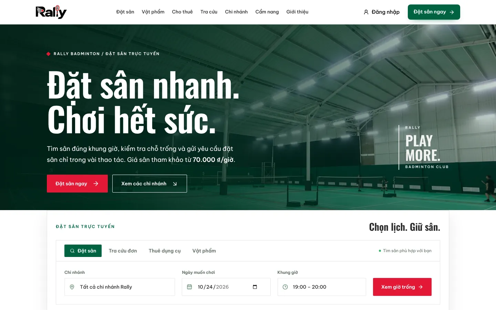
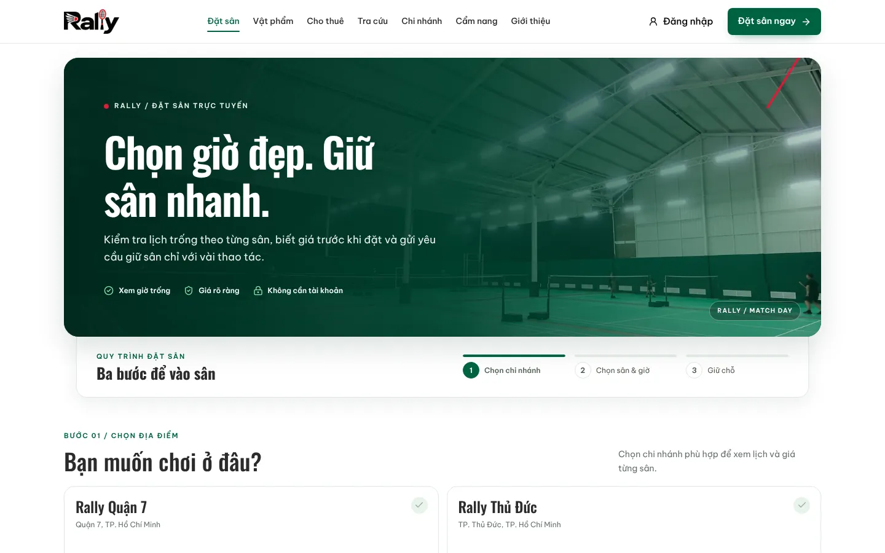
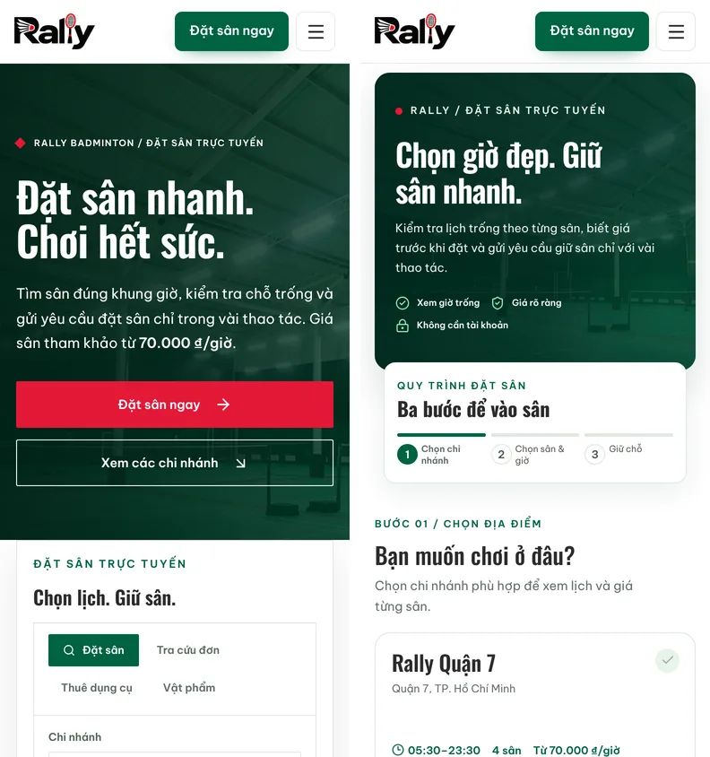
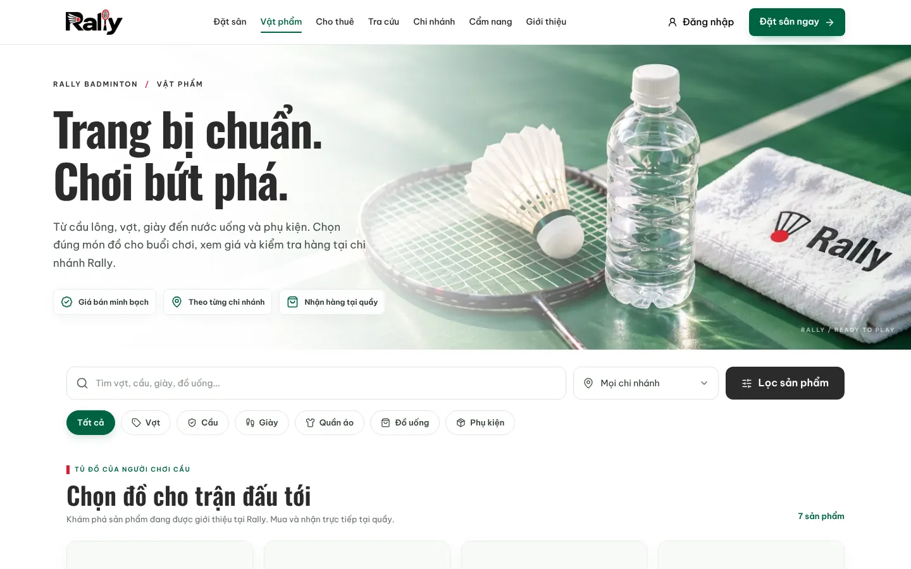
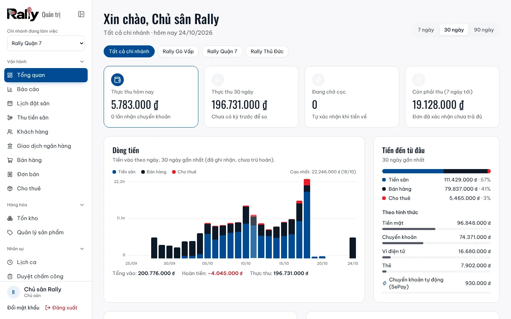
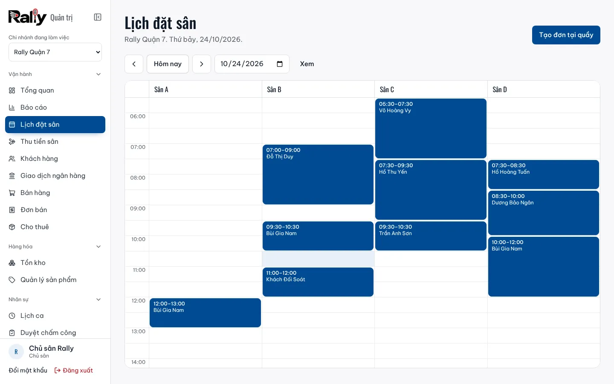
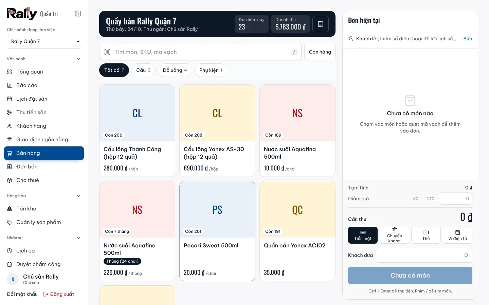
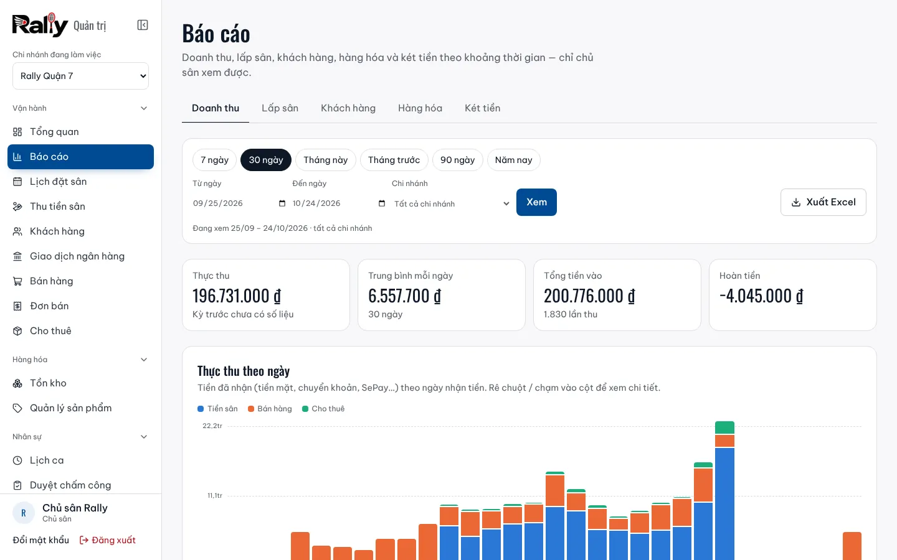
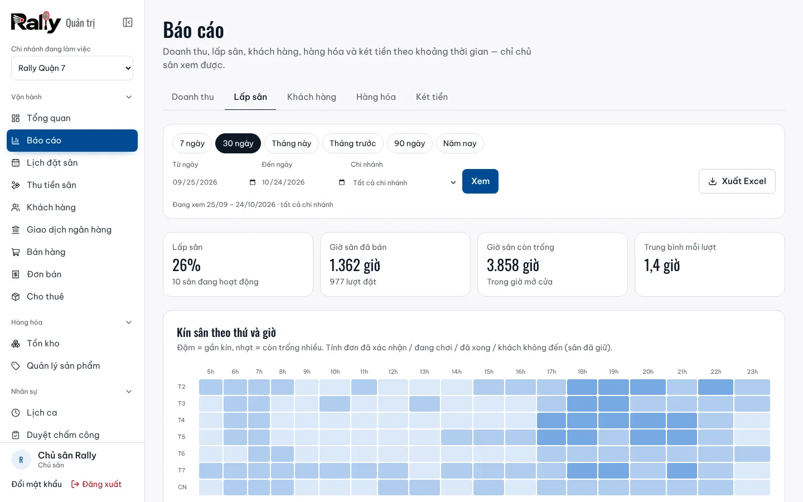

  

<h1 align="center">Rally Badminton</h1>

  <strong>Đặt sân cầu lông trực tuyến và quản lý chuỗi sân trên cùng một hệ thống</strong> 
  Khách xem giờ trống, đặt sân và đặt cọc trong vài thao tác. Chủ sân quản lý lịch, thu tiền, bán hàng, nhân sự và báo cáo ở cùng một nơi.

  <a href="https://rally-eight-tau.vercel.app"><strong>Xem website →</strong></a>

  

---

## Rally là gì?

Rally là phần mềm cho **một thương hiệu sân cầu lông có nhiều chi nhánh**. Hệ thống gồm hai phần dùng chung một nguồn dữ liệu:

- **Website cho người chơi:** tìm chi nhánh, xem bảng giá và giờ trống, đặt sân không cần tạo tài khoản, đặt cọc bằng chuyển khoản, mua vật phẩm, thuê vợt và giày.
- **Trang quản trị cho chủ sân và nhân viên:** lịch đặt sân theo thời gian thực, thu tiền tại quầy, bán hàng, tồn kho, cho thuê, lịch ca, chấm công, bảng lương và báo cáo kinh doanh.

Khách vừa đặt online là lịch ở quầy cập nhật ngay. Tiền chuyển khoản về là đơn tự xác nhận. Cuối ngày chủ sân xem được doanh thu và tiền trong két của từng ca.

## Dành cho người chơi

  

- **Đặt sân trong 3 bước:** chọn chi nhánh, chọn sân và giờ, giữ chỗ. Thấy giá trước khi đặt, không cần tài khoản.
- **Đặt cọc tự xác nhận:** quét mã QR chuyển khoản, tiền về là đơn tự xác nhận, không phải chờ nhân viên gọi lại.
- **Tra cứu đơn** bằng mã đơn hoặc số điện thoại. Hủy online trong thời hạn cho phép.
- **Tài khoản thành viên** (không bắt buộc): lưu lịch sử đặt sân, tích điểm, đăng nhập bằng Google.
- **Vật phẩm và cho thuê:** cầu, vợt, giày, nước uống, phụ kiện. Xem tồn ở từng chi nhánh, thuê dụng cụ ngay tại sân.
- **Cẩm nang cầu lông:** luật chơi, kỹ thuật, cách chọn vợt và giày cho người mới.
- **Dùng tốt trên điện thoại:** giao diện thiết kế cho màn hình nhỏ trước.

  

  

## Dành cho chủ sân và nhân viên

  

| Chức năng | Làm được gì |
| --- | --- |
| **Tổng quan** | Thực thu hôm nay và 30 ngày, dòng tiền theo ngày, đơn chờ cọc, tiền còn phải thu, việc cần xử lý trong ngày |
| **Lịch đặt sân** | Lịch theo sân và giờ, cập nhật ngay khi khách đặt online. Tạo đơn tại quầy, đổi sân, gia hạn giờ chơi, nhận sân, đặt định kỳ |
| **Thu tiền** | Tiền mặt (tự tính tiền thối) hoặc mã QR chuyển khoản tự xác nhận. In hóa đơn khổ 80mm |
| **Bán hàng tại quầy** | Chọn món hoặc quét mã vạch, bán theo đơn vị (chai, lốc, thùng), giảm giá, thuế. **Vẫn bán được khi mất mạng** |
| **Kho và cho thuê** | Tồn kho theo chi nhánh, cảnh báo sắp hết, sổ nhập xuất, cho thuê và nhận trả, phí trễ hạn |
| **Nhân sự** | Lịch ca, tăng ca, chấm công bằng mã QR, duyệt chấm công, bảng lương theo tháng |
| **Phân quyền** | Mỗi nhân viên chỉ thấy và thao tác ở chi nhánh, chức năng được giao |
| **Báo cáo** | Doanh thu, tỷ lệ lấp sân theo thứ và giờ, khách mới và khách quay lại, món bán chạy, hàng tồn, tiền mặt theo ca và thu ngân. Xuất Excel |

  

  

### Báo cáo kinh doanh

  

  

- Biết **khung giờ vắng** để giảm giá và **khung giờ kín** để tăng giá giờ cao điểm.
- So sánh doanh thu giữa các chi nhánh, giữa các sân, theo từng nguồn thu và hình thức thanh toán.
- Đối chiếu **tiền mặt theo ca**, xem ai mở ngăn kéo tiền bằng tay và vào lúc nào.

## Rally Manager: ứng dụng cho quầy và điện thoại

- **Cài như một ứng dụng** trên máy tính quầy, điện thoại và máy tính bảng. Có biểu tượng riêng, mở thành cửa sổ riêng, tự cập nhật khi có bản mới.
- **Thông báo đẩy:** đơn online mới, đã nhận cọc, giao dịch cần xử lý, cảnh báo bảo mật. Bấm vào thông báo là mở đúng trang.
- **Ứng dụng Windows cho máy quầy:** in hóa đơn thẳng ra máy in nhiệt không cần hộp thoại, tự mở ngăn kéo tiền khi thu tiền mặt. Mỗi lần mở ngăn kéo đều được ghi nhật ký.
- **Mất Internet vẫn bán được:** đơn tiền mặt lưu trên máy, có mạng lại thì tự gửi lên đúng giờ bán, không bị ghi trùng.

## An toàn và riêng tư

- **Phân quyền kiểm ở database**, không chỉ ẩn nút trên giao diện. Nhân viên không đọc được dữ liệu ngoài phạm vi được giao.
- **Xác thực 2 lớp** cho chủ sân và nhân viên. Khóa đăng nhập khi nhập sai nhiều lần.
- **Chống giữ sân ảo:** giới hạn lượt giữ chỗ theo thiết bị, số điện thoại và sức chứa chi nhánh. Giữ chỗ quá hạn thì tự trả sân.
- **Dữ liệu cá nhân** theo Luật Bảo vệ dữ liệu cá nhân 2025: văn bản pháp lý có phiên bản, lưu bằng chứng đồng ý, xử lý yêu cầu xem, sửa, xóa dữ liệu, ẩn danh hóa khách.
- **Không xóa cứng lịch sử:** đơn đặt sân, giao dịch, đơn bán chỉ hủy hoặc đánh dấu, mọi thay đổi đều có nhật ký.
- Thông báo trên màn hình khóa không chứa tên hay số điện thoại khách. Thiết bị dùng chung không lưu dữ liệu khách.

## Công nghệ

| Phần | Công nghệ |
| --- | --- |
| Giao diện và máy chủ | Next.js 16 (App Router), React 19, TypeScript, Tailwind CSS 4 |
| Dữ liệu | Supabase: PostgreSQL với Row Level Security, Auth, Storage, Realtime |
| Thanh toán | Chuyển khoản qua mã QR, tự xác nhận bằng SePay |
| Ứng dụng | PWA (Rally Manager), Web Push, Tauri 2 (ứng dụng Windows) |
| Triển khai | Vercel |

## Trạng thái dự án

Rally đã chạy đầy đủ chức năng trên bản thử nghiệm: [rally-eight-tau.vercel.app](https://rally-eight-tau.vercel.app). Dữ liệu trên bản thử nghiệm và trong ảnh chụp là dữ liệu mẫu.

Dự án đang tìm **sân cầu lông muốn dùng thử thực tế**. Nếu bạn quản lý sân và quan tâm, hãy liên hệ qua website.

---

Tài liệu kỹ thuật cho người phát triển: [docs/HUONG-DAN-KY-THUAT.md](docs/HUONG-DAN-KY-THUAT.md)
