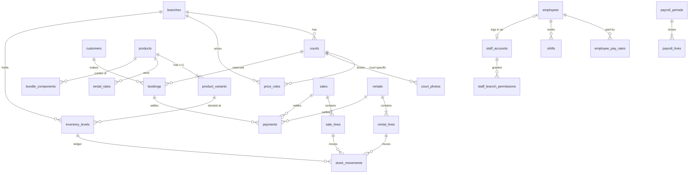

# Rally Badminton — Đánh giá schema Supabase & thiết kế v2

> **Ngày:** 17/10/2026 · **Phạm vi:** Phase 0 (Kiến trúc dữ liệu) — chưa viết code Next.js
> **Đầu vào:** `Supabase Snippet Untitled query.csv` (metadata xuất 17/10/2026 04:24 UTC), *Rally-Badminton-Project-Documentation.md*, *Rally-Backlog…md*
> **Đầu ra:** `supabase/sql/00_init_schema.sql`, `01_core_rpc.sql`, `02_app_rpc.sql` (bổ sung cho giao diện), `03_jobs_optional.sql`, `04_seed_demo_optional.sql`, `supabase/tests/99_verify_schema.sql`

---

## 0. Tóm tắt

Schema cũ giữ được các ý tưởng tốt (khóa GiST chống trùng sân, giữ chỗ chỉ qua server, QR băm 90 giây, khóa kỳ lương) nhưng đã tích tụ nợ kỹ thuật qua ~40 bản vá: **ID thương hiệu viết cứng ở 67 chỗ**, **3 hệ phân quyền chồng nhau**, **tồn kho 2 nguồn**, **tiền nằm ở 2 bảng**, **ca làm không qua được nửa đêm**, **43 khóa ngoại thiếu index**, và **owner vẫn sửa công trực tiếp không qua audit** (P0 trong backlog).

Bản v2 dựng lại từ đầu cho project Supabase mới: **34 bảng, 88 policy, 114 index**, chuẩn hóa 3NF (chỉ giữ các "ảnh chụp lịch sử" có chủ đích), RLS + GRANT + trigger toàn vẹn ở tầng database, và **33 RPC** cho mọi thao tác tiền/booking/kho/chấm công. Đã chạy thật trên PostgreSQL 16 với giả lập Supabase: **126/126 kiểm thử đạt**, 12 phiên đặt cùng một khung giờ đồng thời → đúng **1** thành công.

---

## 1. Hiện trạng snapshot

| Hạng mục | Số lượng | Ghi chú |
|---|---:|---|
| Bảng `public` | 44 | 18 bảng `rally_*`, 11 bảng cộng đồng/demo |
| Hàm | 244 | ~190 là hàm nội bộ của extension `btree_gist`; ~54 hàm nghiệp vụ |
| Policy RLS | 71 | RLS bật trên mọi bảng (tốt) |
| Enum | 7 | `sport_kind` còn `pickleball`, `padel` |
| Hàm có hậu tố phiên bản | 19 | `_v31`, `_v34`, `_v37`… |

---

## 2. Điểm yếu của schema cũ

### 2.1 Chuẩn hóa dữ liệu (3NF)

| # | Vấn đề | Bằng chứng | Hậu quả |
|---|---|---|---|
| N1 | `club_id` là hằng số trên mọi bảng + UUID `c0000000-…0001` viết cứng | 27 policy, 29 hàm, 5 CHECK, 6 DEFAULT | Cột thừa (1 thương hiệu); đổi seed là vỡ toàn bộ RLS |
| N2 | Chiều "môn thể thao" đã chết | `sport_kind` + 5 trigger `check_club_sport` chỉ để ép `badminton` | Mỗi truy vấn giá/sân mang thêm điều kiện vô nghĩa |
| N3 | **Tồn kho 2 nguồn** | `rally_items.stock` **và** `rally_item_variants.stock` | Hai con số lệch nhau, logic thuê phải cộng "legacy_out" |
| N4 | Sản phẩm gắn chi nhánh | `rally_items.venue_id`, `UNIQUE(venue_id, sku)` | Cùng một chai nước phải tạo lại ở mỗi chi nhánh, giá/tên lệch dần |
| N5 | **Tiền nằm 2 nơi** | `payments` + `rally_staff_manual_receipts_v34`; hoàn tiền ở `bookings.refund_amount` và `payments.status` | Tính "đã thu/còn thiếu" phải UNION nhiều bảng |
| N6 | **3 hệ phân quyền** | `club_staff`, `venue_staff`, `rally_staff_phone_access` (cờ boolean) | `is_venue_staff()` cho staff đọc **toàn bộ booking + SĐT khách** mà không cần cờ `can_view_bookings` |
| N7 | Loại mặt sân không liên kết | `courts.surface` là text, `rally_court_surface_types` không có FK | Bảng danh mục vô tác dụng |
| N8 | Mảng trong cột | `pricing_rules.days_of_week int[]` | Vi phạm 1NF, kiểm tra chồng lấn tốn kém |
| N9 | Lương không có lịch sử | `rally_hr_employees` giữ cả `hourly_rate` và `daily_rate` | Một cột luôn vô nghĩa; đổi lương là mất mức cũ |
| N10 | Ca làm dùng `date + time` | `CHECK (end_time > start_time)` | **Không có ca qua nửa đêm**; giờ thực tế mất ngày |
| N11 | Bảng 1-1 tách thừa | `rally_hr_qr_sessions_v37` ↔ `rally_hr_shifts` | Hai nơi cùng giữ giờ vào/ra |
| N12 | Thuê lặp dữ liệu | `rally_rentals.item_id/variant_id/quantity` lặp với `rally_rental_allocations` | Hai đường tính tồn đang thuê |
| N13 | Thời lượng thuê cố định | `CHECK duration_code IN ('1h','2h','day')` | Thêm "30 phút" phải sửa schema |
| N14 | Cột chưa dùng | 15+ cột thuế/đơn vị trong `rally_items` | Bảng phình, form khó hiểu |
| N15 | Bảng demo lẫn production | `matches`, `tournaments`, `player_ratings`, `open_matches`, `waitlist`, `profiles`… | Bề mặt tấn công & nhầm lẫn phạm vi |

### 2.2 Khóa ngoại & toàn vẹn

| # | Vấn đề | Hậu quả |
|---|---|---|
| F1 | **43 khóa ngoại không có index** (vd. `payments.booking_id`, `rally_sales(item_id, venue_id)`, `rally_rental_bundle_lines.component_item_id`) | Join và kiểm tra FK chậm dần khi dữ liệu tăng |
| F2 | `bookings.venue_id` khớp với sân bằng trigger | FK ghép `(court_id, branch_id)` làm việc này rẻ và chắc hơn |
| F3 | `pricing_rules … ON DELETE CASCADE` theo sân/chi nhánh | Xóa sân là mất lịch sử giá |
| F4 | Không có máy trạng thái booking ở DB | `UPDATE` trực tiếp có thể đưa `completed` về `held` |
| F5 | **Owner có policy `ALL` trên `rally_hr_shifts`** | `markAttendance()` sửa công trực tiếp, **bỏ qua audit V37** (P0) |
| F6 | `bookings` thiếu `updated_at`, người xác nhận, lý do hủy | Truy vết phải lục `audit_log` |
| F7 | Không chặn xóa cứng dữ liệu lịch sử | Trái quy tắc soft-delete của dự án |

### 2.3 Index & hiệu năng truy vấn

| # | Vấn đề | Đề xuất |
|---|---|---|
| P1 | `bookings_court_id_during_idx` trùng chức năng index của exclusion constraint | Bỏ; dùng index của `bookings_no_overlap` |
| P2 | `venue_busy_slots` lọc `venue_id + during` nhưng không có index phù hợp | GiST `(branch_id, during)` |
| P3 | `publicBranches()` truy vấn N+1 theo chi nhánh | 1 RPC `list_published_branches()` |
| P4 | 11 cặp policy permissive trùng (role, lệnh) — Supabase Advisor cảnh báo | Mỗi (role, lệnh) đúng 1 policy |
| P5 | `compute_court_price` chạy 1 truy vấn cho mỗi ô 30 phút | Một truy vấn set-based với `LATERAL` |
| P6 | Trigger chống chồng giá không khóa | Advisory lock theo chi nhánh |

### 2.4 Điểm tốt được giữ lại

- Exclusion constraint GiST chống đặt trùng sân.
- Giữ chỗ chỉ gọi từ server (service_role), khóa advisory theo số điện thoại, giới hạn lượt giữ.
- Token QR chỉ lưu SHA-256, hết hạn 90 giây, mã mới thay mã cũ.
- Snapshot mức lương và bảng lương bất biến sau khi chốt.
- Hàm `SECURITY DEFINER` đặt `search_path = ''`; mẫu `(select auth.uid())` trong policy.

---

## 3. Thiết kế v2 — quyết định chính

| Quyết định | Lý do |
|---|---|
| **Bỏ `club_id`**; thương hiệu là bảng singleton `brand_settings` | Hệ thống chỉ phục vụ một thương hiệu; không còn UUID viết cứng |
| `venues` → **`branches`**, bỏ PostGIS (dùng `latitude/longitude`) | Đúng ngôn ngữ nghiệp vụ; ít phụ thuộc extension |
| FK ghép **`(court_id, branch_id)`** cho `bookings`, `price_rules`, `recurring_series` | Database tự đảm bảo sân thuộc đúng chi nhánh |
| **RBAC gọn**: `staff_accounts` (owner/staff) + `staff_branch_permissions` (10 quyền enum theo chi nhánh, có **quyền tiên quyết**) | Một hàm `private.permitted_branch_ids()` dùng chung cho RLS **và** RPC — không còn hai luồng quyền lệch nhau |
| `customers` định danh theo SĐT; `bookings.contact_name` là ảnh chụp | Chuẩn hóa khách, sẵn sàng CRM/đặt định kỳ |
| `bookings`: `kind` (`customer`/`block`), **máy trạng thái bằng trigger**, `price_snapshot`, `refund_entitlement`, `idempotency_key`, mã `RB-XXXXXXXX` | Khóa sân bảo trì dùng chung khóa chống trùng; booking cũ không bị bảng giá mới ảnh hưởng |
| **`payments` là sổ thu/hoàn duy nhất** + view `booking_balances` | Trạng thái tiền tách khỏi trạng thái booking; chống ghi trùng bằng idempotency + unique mã tham chiếu |
| **Catalog toàn thương hiệu**, mọi sản phẩm có ≥1 biến thể, tồn theo chi nhánh ở `inventory_levels`, **sổ `stock_movements`** | `on_hand` chỉ đổi qua sổ (trigger chặn sửa tay, kể cả service_role); `CHECK on_hand >= 0` + khóa dòng chống âm kho khi đồng thời |
| Thuê: `rental_lines`; xuất thuê = trừ kho, trả = cộng lại phần còn tốt | Không cần "legacy_out"; combo tách thành biến thể thành phần, thiếu một món là rollback cả đơn |
| Giá thuê theo `duration_minutes` tự do | Không còn CHECK cố định 1h/2h/day |
| `employee_pay_rates` có `effective_from` | Lịch sử lương; khóa mức lương ảnh hưởng tháng đã chốt |
| `shifts` dùng `timestamptz` + exclusion chống ca chồng; giờ vào/ra gộp vào ca; `paid_minutes` là cột generated | **Hỗ trợ ca qua đêm**, bỏ bảng phiên QR thừa |
| **Mọi thay đổi dữ liệu công bắt buộc có lý do** (trigger), kể cả owner | Đóng lỗ hổng P0 "đường sửa công không audit" |
| `audit_events` chung, chỉ lưu cột thay đổi + `reason` | Một nơi tra cứu lịch sử; bảng append-only |
| Soft-delete: `deleted_at`/trạng thái + trigger **cấm xóa cứng 21 bảng** | Đúng quy tắc dự án |
| Schema `private` (không expose qua API) cho hàm phân quyền/trigger | Client không gọi trực tiếp được các hàm nội bộ |
| Storage: 1 bucket `public-media`, thư mục `branches/`, `courts/`, `products/` | Policy theo quyền; staff có `catalog.edit` chỉ tải được ảnh sản phẩm |
| Bỏ module cộng đồng khỏi schema lõi | Thiết kế lại thành module riêng khi thực sự triển khai |

### 3.1 Phi chuẩn hóa có kiểm soát

Những cột sau **cố ý** lặp dữ liệu; tất cả do trigger/RPC ghi nên không thể lệch:

| Cột | Lý do |
|---|---|
| `bookings.price_snapshot`, `sale_lines.product_name`, `rentals.rate_label/unit_price`, `payroll_lines.employee_name` | Ảnh chụp lịch sử (hóa đơn, phiếu lương) |
| `payments.branch_id` (trigger điền từ đối tượng) | RLS và báo cáo theo chi nhánh không cần join |
| `shifts.work_date` (trigger tính theo timezone chi nhánh) | Gom theo tháng lương, có index |
| `stock_movements.balance_after` | Đối soát kho từng dòng |

---

## 4. Sơ đồ quan hệ (rút gọn)



---

## 5. Ma trận phân quyền

| Dữ liệu | Khách (anon) | Staff (theo quyền & chi nhánh) | Owner |
|---|---|---|---|
| Chi nhánh, sân, ảnh, bảng giá | Đọc bản đã công bố | Đọc | Toàn quyền (không xóa cứng) |
| Lịch bận | RPC `get_branch_busy_slots` (không có thông tin khách) | — | — |
| Giữ chỗ | Qua server Next.js (service_role) | — | — |
| Booking | ✗ | Đọc: `booking.view`; xác nhận: `booking.confirm`; quầy/đổi/hủy/khóa sân: `booking.operate` — **chỉ qua RPC** | Như staff + giảm giá, hủy sau giờ bắt đầu, miễn chính sách |
| Khách hàng | ✗ | Chỉ khách có giao dịch tại chi nhánh mình | Toàn bộ |
| Tiền | ✗ | Ghi thu: `payment.record` | Hoàn tiền, hủy giao dịch |
| Sản phẩm | Đọc đang bán | Đọc: `catalog.view`; sửa danh mục: `catalog.edit` | Toàn quyền |
| Tồn kho | Đọc mặt hàng niêm yết | Điều chỉnh/kiểm kê: `inventory.adjust` (chỉ qua RPC) | Toàn quyền |
| Bán hàng / Thuê | ✗ | `sale.record` / `rental.operate` | + hủy đơn bán |
| Hồ sơ nhân sự, mức lương | ✗ | **Chỉ của chính mình** | Toàn quyền |
| Ca làm | ✗ | Của mình; cả chi nhánh nếu có `shift.view_branch` | Tạo/sửa lịch; sửa công **chỉ qua RPC có lý do** |
| Phiếu lương | ✗ | Chỉ của mình | Toàn quyền, chốt tháng |
| Nhật ký kiểm toán | ✗ | ✗ | Đọc |

Staff chỉ có hiệu lực khi: tài khoản active, **đã đổi mật khẩu tạm**, hồ sơ nhân viên đang làm, và có quyền tiên quyết (vd. `booking.confirm` cần `booking.view`).

---

## 6. Danh sách RPC (`01_core_rpc.sql`)

| Nhóm | RPC | Ai gọi |
|---|---|---|
| Công khai | `list_published_branches`, `get_branch_busy_slots`, `quote_booking` | anon, authenticated |
| Khách qua server | `create_guest_booking_hold`, `lookup_guest_booking`, `cancel_guest_booking` | service_role (sau Turnstile) |
| Booking | `confirm_booking`, `create_counter_booking`, `reschedule_booking`, `cancel_booking`, `check_in_booking`, `mark_booking_no_show`, `create_court_block` | authenticated (kiểm quyền trong hàm) |
| Tiền | `record_booking_payment`, `record_booking_refund`, `void_payment`, `record_rental_payment` | authenticated |
| Kho & bán | `adjust_stock`, `record_stock_count`, `record_sale`, `void_sale` | authenticated |
| Thuê | `checkout_rental`, `return_rental` | authenticated |
| Chấm công & lương | `issue_attendance_qr`, `scan_attendance_qr`, `owner_adjust_attendance`, `close_payroll_month` | authenticated |
| Tài khoản | `my_staff_context`, `branch_publish_checklist` | authenticated |
| Server | `resolve_staff_login`, `service_mark_password_changed` | service_role |
| Định kỳ | `expire_stale_holds`, `complete_finished_bookings` | pg_cron / service_role |

### 6.1 Mã lỗi chính (để Next.js dịch sang tiếng Việt)

Lỗi trả về ở `error.message` (mã ổn định) và `error.details` (chi tiết).

| Mã | Thông điệp gợi ý |
|---|---|
| `SLOT_TAKEN` | Khung giờ vừa có người giữ, vui lòng chọn giờ khác. |
| `HOLD_EXPIRED` | Thời gian giữ chỗ đã hết. |
| `TOO_MANY_HOLDS` / `RATE_LIMITED` | Bạn đang giữ quá nhiều lượt / thao tác quá nhanh, thử lại sau. |
| `OUTSIDE_OPENING_HOURS` / `NO_PRICE_RULE` | Khung giờ ngoài giờ mở cửa / chưa có giá. |
| `RANGE_NOT_ALIGNED` / `INVALID_DURATION` / `OUTSIDE_BOOKING_WINDOW` | Giờ đặt không hợp lệ. |
| `INVALID_PHONE` / `INVALID_NAME` | Số điện thoại / họ tên không hợp lệ. |
| `PERMISSION_DENIED` / `OWNER_REQUIRED` | Bạn không có quyền thực hiện thao tác này. |
| `AMOUNT_EXCEEDS_BALANCE` / `REFUND_EXCEEDS_PAID` | Số tiền vượt số còn phải thu / đã thu. |
| `DUPLICATE_REFERENCE` / `REFERENCE_REQUIRED` | Mã giao dịch đã được ghi / cần mã giao dịch. |
| `IDEMPOTENCY_CONFLICT` | Yêu cầu trùng khóa nhưng khác nội dung. |
| `INSUFFICIENT_STOCK` | Không đủ hàng tại chi nhánh. |
| `QR_EXPIRED_OR_INVALID` / `NO_ELIGIBLE_SHIFT` / `ALREADY_CHECKED_IN` | Mã QR hết hạn / không có ca phù hợp / đã check-in. |
| `PAYROLL_CLOSED` / `UNRESOLVED_SHIFTS` / `MISSING_PAY_RATE` | Tháng đã chốt / còn ca chưa xử lý / thiếu mức lương. |
| `BRANCH_NOT_READY` (details: `NO_ACTIVE_COURT`, `COURT_WITHOUT_PRICE`, `MISSING_ADDRESS`) | Chi nhánh chưa đủ điều kiện công bố. |
| `ATTENDANCE_REASON_REQUIRED` | Sửa công phải có lý do. |
| `LAST_OWNER_REQUIRED` | Không thể vô hiệu hóa owner cuối cùng. |

---

## 7. Ánh xạ cũ → mới

| Cũ | Mới |
|---|---|
| `clubs` | `brand_settings` (không còn `club_id`) |
| `venues` | `branches` |
| `courts` (+ `sport`, `surface` text) | `courts` (+ `surface_code` FK, `status`, `deleted_at`) |
| `rally_court_surface_types` | `court_surfaces` |
| `rally_court_photos` | `court_photos` |
| `pricing_rules` (`days_of_week[]`, `sport`) | `price_rules` (`days_mask`, FK ghép) |
| `bookings` (`guest_name/phone`) | `customers` + `bookings` |
| `payments` + `rally_staff_manual_receipts_v34` + `bookings.refund_amount` | `payments` (charge/refund) + view `booking_balances` |
| `rally_items` (sale/rental, theo chi nhánh) | `products` + `product_variants` + `inventory_levels` |
| `rally_item_photos` | `product_photos` |
| `rally_sales` | `sales` + `sale_lines` + `stock_movements` |
| `rally_rentals` + `rally_rental_allocations` | `rentals` + `rental_lines` + `stock_movements` |
| `rally_rental_rates` | `rental_rates` |
| `rally_rental_bundle_lines` | `bundle_components` |
| `rally_hr_employees` | `employees` + `employee_pay_rates` |
| `rally_hr_shifts` + `rally_hr_qr_sessions_v37` | `shifts` |
| `rally_hr_qr_tokens_v37` | `attendance_qr_tokens` |
| `rally_hr_attendance_overrides_v37`, `rally_staff_ops_audit_v34`, `audit_log` | `audit_events` |
| `rally_hr_adjustments` / `_payroll_periods` / `_payroll_lines` | `payroll_adjustments` / `payroll_periods` / `payroll_lines` |
| `club_staff` + `venue_staff` + `rally_staff_phone_access` | `staff_accounts` + `staff_branch_permissions` |
| `recurring_bookings` | `recurring_series` |
| `matches`, `tournaments`, `player_ratings`, `open_matches`, `waitlist`, `profiles`, `outbox`… | Không đưa vào lõi (module riêng sau) |

---

## 8. Cài đặt

1. Tạo **Supabase project mới** (file 00 tự dừng nếu thấy schema cũ).
2. SQL Editor → chạy lần lượt: `00_init_schema.sql` → `01_core_rpc.sql` → `02_app_rpc.sql` → (tùy chọn) `03_jobs_optional.sql`, `04_seed_demo_optional.sql`.
3. Authentication → **Add user** cho chủ sân (email + mật khẩu mạnh), rồi chạy:
   ```sql
   select private.bootstrap_first_owner('email-chu-san@...', 'Tên chủ sân');
   ```
4. Chạy `supabase/tests/99_verify_schema.sql` → mọi dòng `ok = true`.
5. `.env.local`: chỉ `NEXT_PUBLIC_SUPABASE_URL` và publishable key được public; `SUPABASE_SERVICE_ROLE_KEY` chỉ dùng trong Route Handler/Server Action.

Lưu ý:
- File để ở `supabase/sql/` (chạy tay trong SQL Editor). Nếu sau này dùng Supabase CLI, đổi tên theo dạng `<timestamp>_init_schema.sql` trong `supabase/migrations/`.
- `01_core_rpc.sql` chạy lại an toàn để cập nhật logic; `00` chỉ chạy một lần.
- Trigger cấm xóa cứng áp dụng cả service_role. Khi cần dọn dữ liệu test trên môi trường dev, tạo project dev riêng thay vì tắt trigger trên production.

---

## 9. Kết quả kiểm thử

Chạy trên **PostgreSQL 16** với lớp giả lập Supabase (`auth.uid()`, vai trò `anon`/`authenticated`/`service_role`, `storage`, `realtime`):

- **126/126** kiểm thử nghiệp vụ & RLS đạt: hiển thị anon, cô lập chi nhánh giữa staff, quyền tiên quyết, máy trạng thái booking, khóa chống trùng, giữ chỗ hết hạn tự giải phóng, idempotency thanh toán/bán hàng, chống âm kho, combo thuê rollback nguyên khối, QR check-in/out, ca qua đêm, chốt lương & khóa tháng, owner cuối cùng, payload realtime không lộ SĐT.
- **Đồng thời:** 12 phiên cùng giữ 1 khung giờ → 1 thành công, 11 nhận `SLOT_TAKEN`.
- **Lint kiểu Supabase Advisor:** 0 bảng thiếu RLS, 0 policy permissive trùng, 0 hàm thiếu `search_path`, 0 FK nghiệp vụ thiếu index; policy dùng InitPlan (hàm quyền tính 1 lần/truy vấn).
- `99_verify_schema.sql`: 12/12 mục đạt.

Chưa kiểm thử trên Supabase thật (cần project của bạn): policy trên `storage.objects` và `realtime.send` được viết theo API Supabase hiện hành nhưng chỉ chạy qua giả lập.

---

## 10. Giới hạn & bước tiếp theo

| Hạng mục | Ghi chú |
|---|---|
| Di chuyển dữ liệu cũ | Cần script ETL riêng theo bảng ánh xạ mục 7 (nếu muốn giữ dữ liệu V42) |
| Cổng thanh toán | `payments` đã có `provider/provider_txn_id/provider_payload`; webhook có chữ ký sẽ làm ở phase thanh toán |
| Giờ mở cửa | Một khung/ngày cho mọi thứ, tối đa đến `24:00`; chưa hỗ trợ chi nhánh mở qua đêm |
| Công & OT | Tính theo giờ quét thực tế trừ giờ nghỉ; chưa có chính sách OT/làm tròn |
| Chốt lương | Mốc "tháng đã kết thúc" theo `Asia/Ho_Chi_Minh` |
| Quyền tạo QR | Chỉ owner (giữ như bản cũ); có thể thêm quyền "thiết bị quầy" sau |
| Khách hàng | Chưa có hàm ẩn danh hóa theo yêu cầu xóa dữ liệu cá nhân |
| Realtime cho staff | Nếu cần `postgres_changes`, thêm `bookings` vào publication `supabase_realtime` |
| Module mới theo backlog | `recurring_series` đã có bảng; bàn giao ca, danh sách chờ, gói hội viên sẽ thêm bằng migration riêng |

**Phase 1 đề xuất:** script `.ps1` dựng khung Next.js App Router (cấu trúc thư mục, Supabase client server/browser, type sinh từ schema, design tokens Tailwind v4 theo màu/font thương hiệu).

---

## 11. Migration `05_product_details.sql` — Quản lý sản phẩm

Chạy sau 00–02 (và 04 nếu có dữ liệu mẫu). Chạy lại nhiều lần vẫn an toàn (`add column if not exists`, `create or replace`).

| Thay đổi | Chi tiết |
|---|---|
| `products` thêm cột | `excerpt` (≤300), `unit_label` (≤20), `tags text[]` (≤20 nhãn, chỉ mục GIN), `seo_title` (≤70), `seo_description` (≤320), `show_on_website`, `show_on_pos` (mặc định `true`) |
| `product_variants` thêm cột | `cost_price` (giá vốn, ≥0), `barcode` (duy nhất trong các biến thể chưa ngừng) |
| Bảo mật giá vốn | `anon` và `authenticated` chỉ được `select` danh sách cột cho phép — không có `cost_price`. Giá vốn đọc qua `get_variant_costs(product_id)` (SECURITY DEFINER, trả rỗng nếu không có quyền `catalog.view`). Thêm cột mới vào `product_variants` thì phải grant select cột đó |
| Kênh bán | Policy đọc công khai và `list_catalog` lọc `show_on_website`; quầy bán/cho thuê lọc `show_on_pos` |
| `create_product_full(p jsonb) → uuid` | Tạo sản phẩm + biến thể + bày bán theo chi nhánh + tồn đầu kỳ (qua `adjust_stock`, cần quyền `inventory.adjust`) + gói giá thuê, trong một giao dịch. `SECURITY INVOKER` — RLS áp như ghi tay |
| `update_product_full(p_id, p jsonb)` | Sửa thông tin, thêm/sửa biến thể, đổi biến thể mặc định, ngừng biến thể (xóa mềm) trong một giao dịch |
| Mã lỗi mới | `VARIANT_REQUIRED`, `BUNDLE_SINGLE_VARIANT`, `PRODUCT_NOT_FOUND`, `VARIANT_NOT_FOUND`, `INVALID_LINES` |

Kiểm tra: `supabase/tests/99_verify_schema.sql` dòng 13–14.

---

## 12. Migration `06_product_tax.sql` — Thuế sản phẩm

Chạy sau `05`. Chạy lại an toàn. Quy ước: **giá bán đã gồm thuế GTGT** (phương pháp khấu trừ).

| Thay đổi | Chi tiết |
|---|---|
| `brand_settings` | `tax_method` (`deduction` khấu trừ / `direct` trực tiếp), `default_vat_rate` (mặc định 8%), `tax_code` (MST, in trên phiếu) |
| `products` | `invoice_name`, `taxable` (có/không chịu thuế, mặc định `false` cho dữ liệu cũ; sản phẩm mới tạo từ màn quản trị mặc định có thuế), `tax_industry` (nhóm ngành nghề), `vat_use_default`, `vat_rate` (0–20%) |
| Tỷ lệ thuế trực tiếp | `private.direct_tax_rates()` theo Thông tư 40/2021/TT-BTC: hàng hóa 1% + 0,5%; dịch vụ 5% + 2%; cho thuê tài sản 5% + 5%; sản xuất/vận tải 3% + 1,5%; khác 2% + 1% (GTGT + TNCN) |
| `sale_lines` | `tax_method`, `vat_rate`, `vat_amount`, `pit_rate`, `pit_amount` — trigger `sale_lines_tax` chụp thuế lúc bán, đổi cấu hình sau không làm sai đơn cũ |
| Cách tính | Khấu trừ: VAT = thành tiền × r / (100 + r). Trực tiếp: GTGT/TNCN = thành tiền × tỷ lệ. Giảm giá trên đơn chia theo tỷ lệ khi hiển thị tổng |
| `create_product_full` / `update_product_full` | Thêm phần thuế qua `private.apply_product_tax` (INVOKER — RLS `catalog.edit` vẫn áp dụng) |

Giới hạn: phiếu thuê (`rental_lines`) chưa tách thuế. Số thuế là ước tính để đối chiếu, không thay hóa đơn điện tử.

Kiểm tra: `supabase/tests/99_verify_schema.sql` dòng 15.

---

## 13. Migration `07_units_options.sql` — Đơn vị tính & thuộc tính biến thể

Chạy sau `06`. Chạy lại an toàn.

| Thay đổi | Chi tiết |
|---|---|
| `products.option1_name`, `option2_name` | Tên 2 thuộc tính biến thể (Kích thước, Màu sắc, Dung tích, Chất liệu… hoặc tự đặt). Giá trị vẫn ở `product_variants.size_label` (thuộc tính 1) và `color_label` (thuộc tính 2). Dữ liệu cũ được đặt tên mặc định |
| `product_units` (mới) | Đơn vị quy đổi theo sản phẩm: `name`, `conversion` (2–10.000 đơn vị cơ bản), `price` (để trống = giá × quy đổi), `barcode` (duy nhất). RLS: ai thấy sản phẩm thì đọc được; ghi cần `catalog.edit`; không xóa cứng (xóa mềm `deleted_at`) |
| `sale_lines.unit_id`, `unit_name`, `unit_conversion` | Chụp đơn vị lúc bán. Kho trừ `quantity × unit_conversion` đơn vị cơ bản |
| `record_sale` | Mỗi dòng nhận thêm `unit_id`; giá = giá riêng của đơn vị hoặc giá cơ bản × quy đổi; kiểm tra đơn vị thuộc đúng sản phẩm và chưa bị xóa |
| `void_sale` | Hoàn kho theo `quantity × unit_conversion` |
| `private.apply_product_tax` | Mở rộng: ghi cả tên thuộc tính và danh sách đơn vị (`units`, `archived_unit_ids`) khi tạo/sửa sản phẩm |

Tồn kho luôn đếm theo đơn vị cơ bản (`products.unit_label`). Kiểm tra: `99_verify_schema.sql` dòng 16.

## 14. Migration `09_rental_pricing.sql` — Giá thuê theo hình thức & phụ phí trả trễ

**Vấn đề:** gói thuê chỉ có thời lượng + giá, không phân biệt dùng tại sân hay mang ra ngoài; phí trả trễ do nhân viên tự nhập tay nên mỗi người tính một kiểu, không giải thích được với khách.

**Thay đổi:**

- `rental_rates.usage` (`on_site` | `take_out`) và `rental_rates.billing` (`duration` | `session`). Gói "hết trận" chỉ dùng tại sân (CHECK). Khóa trùng đổi thành `(product_id, usage, billing, duration_minutes)` — cùng 1 ngày có thể có giá tại sân và giá mang về khác nhau.
- Chính sách trễ trên từng gói: `grace_minutes`, `overtime_block_minutes`, `overtime_block_price` (NULL = chia theo giá gói, làm tròn lên 1.000đ), `overtime_cap` (trần / món). Trigger điền mặc định theo hình thức: tại sân 10 phút, hết trận 15 phút, mang về 30–60 phút; block 30 phút (gói > 4 giờ: 60 phút, gói ≥ 1 ngày: 12 giờ).
- `rentals` chụp lại toàn bộ chính sách khi giao đồ + `booking_id` (đồ thuê theo trận gắn với lượt đặt), `collateral` (vật cầm cọc, bắt buộc khi mang ra ngoài), `late_minutes`, `late_fee_auto` (hệ thống tính), `late_fee` (thực thu), `late_fee_reason`.
- Công thức duy nhất `private.rental_overtime(due, at, qty, grace, block, block_price, cap)`: trễ ≤ ân hạn → 0; quá ân hạn → `ceil(trễ / block) × giá block × số món`, đếm từ giờ hẹn trả, giới hạn bởi trần. Giao diện dùng bản TypeScript cùng công thức (`src/lib/rental-fee.ts`, có unit test) để hiển thị tạm tính; số chính thức do database tính lúc nhận trả.
- `private.rental_effective_due`: thuê hết trận → hạn trả theo giờ kết thúc sân hiện tại của lượt đặt (khách gia hạn sân thì không bị tính trễ oan).
- `checkout_rental` thêm `p_booking_id`, `p_collateral` (bỏ bản cũ để không trùng hàm). `return_rental`: `p_late_fee` NULL = thu đúng mức tự tính; nhập thấp hơn bắt buộc `p_late_fee_reason` (`LATE_FEE_REASON_REQUIRED`).
- `rental_overtime_preview(rental_id)` (security invoker, theo RLS) để xem trước phụ phí.

**Ví dụ:** vợt 1 giờ 30.000đ → block 30 phút = 15.000đ, ân hạn 10 phút. Thuê lúc 14:00, hẹn 15:00, 16:00 mới trả → trễ 60 phút → 2 block → phụ phí 30.000đ.


## 15. Migration `11_members.sql` — Tài khoản thành viên, điểm, hạng

- **Bảng mới:** `member_profiles` (1–1 với `auth.users`; họ tên, SĐT duy nhất, cách đăng ký, điểm khả dụng, tổng điểm, hạng, khóa, buộc đổi mật khẩu, ghi chú nội bộ) và `member_point_ledger` (sổ điểm chỉ thêm; mỗi đơn chỉ cộng 1 lần nhờ unique index `booking_id where kind='booking'`).
- **Cột mới:** `bookings.member_user_id` — đơn thuộc thành viên. Gắn khi giữ sân lúc đang đăng nhập (`service_attach_member_booking`, user lấy từ phiên phía máy chủ) hoặc khi khách tự nhận bằng **mã đơn + SĐT** (`member_claim_booking`).
- **Không trùng tài khoản:** trigger trên `member_profiles` (chặn user nhân sự) và `staff_accounts` (chặn user thành viên). Đăng nhập khách gọi `ensure_member_profile()` → lỗi `STAFF_ACCOUNT` thì đăng xuất ngay.
- **Không lộ lịch theo SĐT:** SĐT thành viên chưa xác minh (chưa OTP) nên chỉ dùng để liên kết hồ sơ `customers` cho nhân viên xem; thành viên chỉ thấy đơn có `member_user_id = auth.uid()`.
- **Điểm & hạng:** trigger `bookings_award_member_points` cộng `floor(total/10000)` khi đơn chuyển `completed` (kể cả khi nhận lại đơn đã hoàn tất). Trigger trên sổ điểm cập nhật số dư (không âm → `POINTS_INSUFFICIENT`), tổng điểm và hạng (`private.member_tier_for`: 300 / 1.000 / 3.000).
- **Quyền:** bảng không mở INSERT/UPDATE/DELETE; đọc theo RLS (chính chủ, hoặc chủ sân / nhân sự có `booking.view`). Cột `staff_note` không cấp SELECT cho `authenticated`. RPC `service_*` và `resolve_member_login` chỉ cho `service_role`. Sửa thành viên, điều chỉnh điểm, khóa: `private.require_owner()`.
- **Kiểm tra:** `99_verify_schema.sql` dòng 18.

## 16. Migration `12_branch_map.sql` — Bản đồ Google nhúng

- **Cột mới:** `branches.map_embed_url` — chỉ là đường dẫn `src` dạng `https://www.google.com/maps/embed?pb=…` (ràng buộc `branches_map_embed_fmt`, tối đa 2.000 ký tự). Không lưu HTML.
- Chủ sân dán nguyên mã `<iframe …>` ở trang quản trị; máy chủ tách `src` và kiểm tra (`features/branches/lib/map-embed.ts`), database kiểm tra lại. Website tự dựng thẻ `<iframe>` nên không thể chèn mã lạ.
- Chưa dán mã: trang Giới thiệu dùng bản đồ tìm theo địa chỉ (`google.com/maps?q=…&output=embed`, không cần API key).
- Quyền: cột thuộc bảng `branches` (đọc công khai khi chi nhánh đã công bố, chỉ chủ sân sửa).
- **Kiểm tra:** `99_verify_schema.sql` dòng 19.

## 17. Migration `13_performance.sql` — Chỉ mục & tối ưu truy vấn

- **pg_trgm** (schema `extensions`; nếu dự án cũ cài ở schema khác thì dùng đúng schema đó) + chỉ mục GIN trigram cho tìm kiếm `ilike '%…%'`: `customers(phone, full_name)`, `member_profiles(full_name, phone)`, `products(name)` (chỉ sản phẩm chưa xóa).
- **Danh sách sắp theo thời gian:** `customers(created_at desc)`, `member_profiles(created_at desc)`, `audit_events(occurred_at desc, id desc)` và `(table_name, occurred_at desc, id desc)` cho trang Nhật ký (BRIN cũ không phục vụ `ORDER BY … LIMIT`), `payroll_adjustments(month, created_at desc)`.
- **`admin_list_members`:** cùng chữ ký, cùng kết quả, cùng kiểm tra quyền; `booking_count` và `customer_id` chỉ tính cho các dòng của trang đang xem thay vì mọi thành viên khớp bộ lọc.
- Phía ứng dụng (không cần SQL): lịch ngày ở quản trị lấy thanh toán kèm đơn (`payments(...)`) và tính số dư cùng công thức với view `booking_balances`; bảng lương lấy dòng lương lồng trong kỳ lương; nhật ký lấy tên tài khoản song song.
- Chạy lại an toàn (`if not exists`, `create or replace`), có `analyze` để dùng chỉ mục ngay.
- **Kiểm tra:** `99_verify_schema.sql` dòng 20.

## 18. Migration `14_guest_phone_lookup.sql` — Tra cứu đơn bằng số điện thoại

- **Bảng mới** `private.guest_lookup_attempts(kind, key, created_at)` — chỉ để giới hạn tần suất (`phone`, `client` = IP đã băm SHA-256, `reveal_fail` = đơn / thiết bị nhập sai tên). Không mở cho anon/authenticated; tự dọn dòng cũ hơn 1 ngày.
- **`lookup_guest_bookings_by_phone(p_phone, p_client)`** (service role): đơn của khách vãng lai theo SĐT (`member_user_id is null`, nguồn `online`/`counter`, 180 ngày + sắp tới, tối đa 40). Trả mã che (`private.mask_booking_code`), tên gọi, giờ, chi nhánh, sân, tổng tiền, đã trả; kèm số đơn thuộc tài khoản thành viên. 10 lần/giờ mỗi SĐT, 30 lần/giờ mỗi thiết bị.
- **`reveal_guest_booking(p_booking_id, p_phone, p_name, p_client)`** (service role): so họ tên với `bookings.contact_name` hoặc `customers.full_name` qua `private.fold_vn_name` (bỏ dấu tiếng Việt, hoa/thường, khoảng trắng). Đúng → trả như `lookup_guest_booking` (mã đầy đủ, hủy được). Sai → trả `{"error":"BOOKING_NAME_MISMATCH"}` (không `raise` để dòng nhật ký sai tên không bị hoàn tác); 5 lần sai/giờ mỗi đơn, 15 lần/giờ mỗi thiết bị.
- **Kiểm tra:** `99_verify_schema.sql` dòng 21.

## 19. Migration `15_sepay_deposit.sql` — Cọc chuyển khoản SePay & Tổng quan

- **Cột mới:** `brand_settings.bank_code / bank_account_no / bank_account_name / transfer_memo_prefix / transfer_auto_confirm`, `branches.bank_*`, `branches.transfer_memo_prefix` (tài khoản riêng của chi nhánh, trống = dùng tài khoản thương hiệu). Ràng buộc định dạng + "có ngân hàng thì phải có số tài khoản". Đọc công khai (hiện trên mã QR).
- **Bảng `bank_transactions`** (RLS: chủ sân mọi dòng; nhân viên có `payment.record` thấy dòng của chi nhánh mình + dòng chưa khớp chi nhánh). Duy nhất `(provider, provider_txn_id)`; trạng thái `matched / unmatched / review / ignored`; không xóa, chỉ đổi trạng thái kèm ghi chú + người xử lý.
- **`record_sepay_transaction(p_payload)`** (chỉ service role, gọi từ route webhook sau khi kiểm chữ ký): khóa theo id SePay, ghi giao dịch, `private.extract_booking_code` tìm `RB…` trong `code`/`content`, gọi `private.apply_bank_transaction`.
- **`private.apply_bank_transaction`**: ghi `payments` (`method = gateway`, `provider = sepay`, `provider_txn_id`, `idempotency_key = sepay:<id>`); `held` + đủ cọc → `confirmed`; `expired` + đủ cọc → mở lại bằng chuyển trạng thái đặc biệt `expired → confirmed` (chỉ khi `rally.deposit_revive = on` trong giao dịch này; ràng buộc chống trùng giờ vẫn chặn nếu đã có người đặt → `review`); đơn hủy / chuyển dư → `review`. Lần chuyển thiếu trước đó tự về `matched` khi đơn đã đủ cọc.
- **`match_bank_transaction` / `dismiss_bank_transaction`**: nhân viên gán tay (cần `payment.record` ở chi nhánh của đơn) / đánh dấu đã xử lý (giao dịch chưa khớp chi nhánh: chỉ chủ sân).
- **`admin_dashboard(p_branch_id, p_days)`**: `null` = tất cả chi nhánh (chỉ chủ sân). Mỗi phần chỉ trả khi người gọi có quyền tương ứng ở chi nhánh đó (`booking.view`, `payment.record`/chủ sân, `sale.record`, `rental.operate`, `catalog.view`, `shift.view_branch`, xem thành viên).
- **Kiểm tra:** `99_verify_schema.sql` dòng 22.

## 20. Migration `16_alerts_reconcile.sql` — Email cảnh báo & đối soát SePay

- **Bảng `notification_settings`** (một dòng): `alert_emails text[]` (≤ 5, trống = email tài khoản chủ sân), `alert_on_review`, `alert_on_unmatched`. RLS: **chỉ chủ sân** đọc/sửa (khác `brand_settings` đọc công khai).
- **Cột `bank_transactions.alerted_at`** + chỉ mục một phần cho giao dịch chưa báo; chỉ mục `reference_code`.
- **Bảng `reconcile_runs`**: nhật ký mỗi lần đối soát (`cron / manual / vercel`, số giao dịch đọc, số ghi bù, lỗi). Chủ sân đọc; tự xóa dòng quá 30 ngày.
- **`record_sepay_transaction`** thay thế: thêm chống trùng theo `reference_code + amount + transfer_type + account_number` (giao dịch từ API đối soát có thể khác id webhook).
- **Hàm chỉ service role:** `service_alert_recipients`, `service_pending_alerts(p_limit)` (giao dịch `review`/`unmatched` chưa báo trong 3 ngày + đơn, khách, sân), `service_mark_alerted(ids)`, `service_bank_accounts`, `service_reconcile_start(source)` (trả mốc thời gian bắt đầu), `service_reconcile_finish(...)`.
- **`17_reconcile_cron_optional.sql`**: `pg_cron` + `pg_net` gọi `POST /api/cron/sepay-reconcile` mỗi 15 phút; URL và khóa đọc từ Supabase Vault (`rally_site_url`, `rally_cron_secret`), không nằm trong file.
- **Kiểm tra:** `99_verify_schema.sql` dòng 23.

## 21. Migration `18_overtime.sql` — Tăng ca có đồng ý & lương tăng ca

- **Bảng `shift_overtime`**: `shift_id`, `employee_id`, `branch_id`, `minutes` (15–480, bước 15), `hourly_rate` (giá tăng ca), `reason`, `status` `pending / accepted / declined / cancelled`, `consent` `app / in_person`, người đề nghị / trả lời + thời điểm. Một đề nghị hiệu lực mỗi ca (unique index một phần). RLS: chỉ chủ sân và chính nhân viên đọc; ghi chỉ qua RPC; cấm xóa cứng; audit + `updated_at`.
- **RPC**: `offer_overtime(shift, minutes, rate, reason, agreed_in_person)` (chủ sân; chặn tháng đã chốt, ca vắng/hủy, trùng ca kế tiếp, tổng > 16 giờ, hỏi qua app khi khung đã qua), `respond_overtime(offer, accept, note)` (chính nhân viên, trước khi hết khung), `cancel_overtime(offer, reason)` (chủ sân).
- **`private.overtime_worked_minutes`**: phút sau giờ ra ca theo lịch (từ lúc vào nếu vào muộn hơn), tối đa phút đã đồng ý và tổng công.
- **`close_payroll_month` / `preview_payroll_month`** viết lại: phút tăng ca × giá tăng ca + phần còn lại × giá thường; `payroll_lines.overtime_minutes / overtime_pay` (đã gồm trong `base_pay`); preview trả thêm `overtime_minutes`, `overtime_pay`, `pending_overtime` (đổi kiểu trả về nên `drop function` trước).
- **`scan_attendance_qr`**: hạn quét ra = giờ ra ca + 4 giờ + phút tăng ca đã đồng ý.
- **Kiểm tra:** `99_verify_schema.sql` dòng 24.

## 22. Migration `19_staff_checkout.sql` — Nhân viên & chuyển khoản tại quầy

- **`shift_people(branch, from, to)`** (security definer): tên + mã nhân viên có ca ở chi nhánh trong khoảng ≤ 62 ngày, chỉ cho chủ sân hoặc người có `shift.view_branch` ở chi nhánh đó. RLS `employees` giữ nguyên (nhân viên chỉ đọc hồ sơ của mình).
- **`my_month_summary(month)`**: tổng quan tháng của chính nhân viên (`current_employee_id`), cùng công thức lương với `close_payroll_month` (giá thường + tăng ca), cộng thưởng / trừ khấu trừ; đi trễ = vào ca muộn > 5 phút.
- **`bank_transactions.sale_id`** + ràng buộc `bank_txn_matched_fields` cho phép khớp đơn bán.
- **`private.new_transfer_code()`**: mã `RB` + 8 ký tự, không trùng mã đơn đặt sân và mã chuyển khoản đã cấp.
- **`record_sale`** thay thế: `bank_transfer` không có mã giao dịch → khoản thu `pending` với `reference` = mã chuyển khoản; trả thêm `transfer_code`, `payment_status`.
- **`private.apply_transfer_intent`** + **`record_sepay_transaction`** thay thế: mã RB không phải đơn đặt sân → tìm khoản thu chờ; đủ tiền → `succeeded` + giao dịch `matched`; thiếu / dư → `review` (email cảnh báo có mã đơn bán — `service_pending_alerts` thêm `sale_code`).
- **`sale_transfer_status`**, **`settle_pending_sale`** (khoản chờ → `failed`, ghi khoản mới tiền mặt / chuyển khoản có mã), **`cancel_pending_sale`** (nhân viên `sale.record`, đơn chưa thu tiền, ≤ 24 giờ; trả kho, giữ lịch sử).
- **Kiểm tra:** `99_verify_schema.sql` dòng 25.

## 23. Migration `20_booking_extend.sql` — Khách chơi thêm giờ

- **`private.bookings_before_write`** thay thế: giữ nguyên chặn sửa `during` / giá khi đơn không còn `held` / `confirmed`, **trừ** khi `rally.booking_extend = on` (chỉ `extend_booking` bật) và thay đổi chỉ là kéo dài giờ kết thúc (cùng sân, cùng giờ bắt đầu) của đơn `checked_in` / `completed`.
- **`court_extend_options(booking)`** (stable, security definer; chủ sân hoặc `booking.view` ở chi nhánh): giờ trống tới (đơn kế tiếp `confirmed` / `checked_in` / `held` chưa hết hạn, hoặc giờ đóng cửa, tối đa +6 giờ; đơn `completed` chặn ở `now()`), danh sách lựa chọn theo bước giá kèm tiền (`private.quote_court_price` trên phần thêm).
- **`extend_booking(booking, new_end, note)`** (`booking.operate`): kiểm tra bước giá, giới hạn, trùng lịch (sau `expire_overlapping_holds`; ràng buộc `bookings_no_overlap` vẫn bảo vệ đơn `checked_in`), báo giá phần thêm, gộp `price_snapshot` theo `rule_id` + giá/giờ, `subtotal += tiền thêm` (cọc, giảm giá giữ nguyên). Lỗi: `EXTEND_END_INVALID`, `EXTEND_TOO_LONG`, `EXTEND_COMPLETED_FUTURE`, `COURT_UNAVAILABLE`, `SLOT_TAKEN`. Ghi nhật ký qua `private.set_audit_reason`.
- Không đổi RLS; hai hàm chỉ `authenticated` gọi được.
- **Kiểm tra:** `99_verify_schema.sql` dòng 26.

## 24. Migration `21_attendance_rules.sql` — Quy tắc chấm công

- **`attendance_settings`** (một dòng, `id = true`): `late_grace_minutes` (10), `late_out_review_minutes` (30), `fix_request_hours` (24), `forgot_warn_count` (3), `qr_ttl_seconds` (45, 15–300), `auto_close_forgotten` (true). Mọi tài khoản đăng nhập đọc được; chỉ sửa qua `update_attendance_settings` (chủ sân, ghi nhật ký).
- **`shifts`** thêm `scanned_in_at` / `scanned_out_at` (giờ quét QR thật, không bao giờ bị ghi đè khi sửa giờ), `in_source` (`qr` / `request` / `owner`), `out_source` (`qr` / `request` / `owner` / `auto`), `actual_time_decision` (`approved` / `kept` / null).
- **`paid_minutes`** bỏ biểu thức generated, tính bằng trigger `shifts_zz_paid` qua `private.shift_paid_minutes(...)`: kẹp `[checked_in, checked_out]` vào `[scheduled_start, scheduled_end + tăng ca đã accepted]`, trừ nghỉ. `actual_time_decision = 'approved'` thì dùng giờ thực tế. `shift_overtime_zz_recompute` chạm lại ca khi tăng ca đổi trạng thái. Backfill các tháng chưa chốt.
- **`attendance_fix_requests`**: `kind` in/out, `claimed_at`, `recorded_at` (giờ đang ghi lúc gửi), `reason`, `status` pending/approved/rejected/cancelled, `decided_by/at`, `decision_note`. Unique pending theo (shift, kind). RLS: chủ sân hoặc chính nhân viên đó (chỉ đọc; ghi qua RPC). Audit + chặn xóa cứng.
- RPC: `request_attendance_fix` (nhân viên của ca; hạn `scheduled_end + fix_request_hours`; không ở tương lai; giờ vào trong `[start − 60 phút, end)` và sớm hơn giờ đang ghi; giờ ra sau giờ vào, tối đa `end + tăng ca + 4h`; `FIX_SCAN_INSTEAD` khi ca chưa kết thúc mà chưa quét ra), `cancel_attendance_fix`, `decide_attendance_fix` (chủ sân; từ chối bắt buộc ghi chú; duyệt giờ ra trễ hơn khung → `actual_time_decision = 'approved'`), `decide_actual_time` (chủ sân).
- **Tự đóng ca**: `private.close_forgotten_shifts()` hủy đề nghị tăng ca pending đã quá giờ; đóng ca còn mở sau `end + tăng ca + 4h` với `checked_out = end + tăng ca`, `out_source = 'auto'`. Gọi qua `close_forgotten_shifts()` (chủ sân) và `service_close_forgotten_shifts()` (service_role, cron).
- Trigger `payroll_periods_check_fixes`: chặn chốt tháng còn yêu cầu pending (`PENDING_ATTENDANCE_FIXES`).
- `attendance_review_counts()` / `attendance_review_queue()` (chủ sân) cho thanh bên và trang *Duyệt chấm công*. `my_month_summary` lấy ân hạn từ settings, thêm `forgot_count`, `pending_fixes`, `forgot_checkout_count`.
- **QR**: `attendance_qr_tokens.created_by` nullable, thêm `kiosk_id`. `private.issue_qr_token` chỉ xóa mã đã hết hạn (nhiều màn hình chạy song song), tối đa 30 mã sống / chi nhánh, TTL theo settings. `scan_attendance_qr` ghi giờ quét + nguồn, trả `late_minutes` / `capped`.
- **`attendance_kiosks`**: `token_hash` (sha256, unique), `branch_id`, `name`, `last_seen_at`, `revoked_at`. Chủ sân đọc; `create_attendance_kiosk` / `revoke_attendance_kiosk` (chủ sân). `kiosk_issue_qr(device_token, qr_hash)` là RPC **duy nhất mới cấp cho anon** — chỉ cấp mã QR cho đúng chi nhánh của máy còn hiệu lực, sai mã → `KIOSK_INVALID`.
- **Kiểm tra:** `99_verify_schema.sql` dòng 27 (dòng 1 và 5 cập nhật theo bảng / RPC mới).

## 25. Migration `22_privacy_security.sql` — Bảo vệ dữ liệu cá nhân & bảo mật

Căn cứ Luật 91/2025/QH15 (Điều 4 quyền chủ thể dữ liệu, Điều 9 sự đồng ý, Điều 10 rút lại, Điều 19 xử lý không cần đồng ý) và Nghị định 356/2025/NĐ-CP (Điều 5 thời hạn, Điều 6 lưu bằng chứng đồng ý).

- **`brand_settings`** thêm `legal_name`, `legal_address`, `privacy_email`, `privacy_contact` (ràng buộc độ dài / email). `tax_code` đã có từ 06.
- **`legal_documents`** (`code` privacy / terms / cancellation / cookies, `version`, `title`, `summary`, `body`, `change_note`, `effective_at`): unique (code, version), chỉ thêm (`forbid_update`, `forbid_hard_delete`), audit insert. anon / authenticated chỉ SELECT. Đăng bản mới qua `publish_legal_document` (chủ sân; khóa advisory theo code; không ghi lùi ngày, hẹn tối đa 90 ngày; bắt buộc ghi nội dung thay đổi). `private.current_legal_document(code)` = bản có hiệu lực mới nhất. Seed 4 bản nháp phiên bản 1 (placeholder `{{...}}` do web điền; `{{bang_huy_coc}}` đọc cấu hình chi nhánh, `{{bang_luu_tru}}` đọc `data_retention_policies`).
- **`privacy_consents`** (`customer_id` / `auth_user_id`, `booking_id`, `purpose` booking_terms / account_terms / marketing, `granted`, `privacy_doc_id`, `terms_doc_id`, `source`, `wording`, `ip_hash`, `user_agent`, `created_by`): chỉ thêm; unique (booking_id, purpose). RLS đọc: chủ sân, chính tài khoản, hoặc hồ sơ khách gắn tài khoản (`private.my_customer_id()`). Trigger `privacy_consents_sync` đồng bộ `marketing_opt_in` (khách + thành viên); trigger `marketing_flag_audit` trên customers / member_profiles tự ghi bằng chứng khi cờ đổi ở màn hình cũ (`rally.consent_sync` chống lặp).
- RPC: `create_guest_booking_hold_v2` (service_role; gọi `create_guest_booking_hold` + ghi bằng chứng cùng giao dịch; thiếu câu điều khoản → `TERMS_NOT_ACCEPTED`), `service_record_member_consents` (bỏ qua nếu đã có account_terms), `member_set_marketing`.
- **`data_subject_requests`** (`code` DR-…, `kind`, `status`, liên hệ, `verified`, `ack_due_at` = +2 ngày làm việc (`private.add_working_days`, bỏ T7/CN giờ VN), `due_at` = +10 / 15 / 20 ngày theo loại, `extended_due_at` (một lần), `resolution_note`, `redacted_at`): RLS chủ sân hoặc chính tài khoản. `service_submit_data_request` (service_role; giới hạn 5/giờ/IP băm, 3/ngày/SĐT; tự xác minh khi SĐT khớp mã đơn hoặc gửi từ tài khoản), `update_data_request` (chủ sân; hoàn tất / từ chối bắt buộc ghi kết quả; hoàn tất yêu cầu xem / sửa / xóa phải đã xác minh), `data_request_counts`.
- **Ẩn danh hóa**: `customers.anonymized_at`, `member_profiles.anonymized_at`; `customers_phone_fmt` cho phép `x` + 12 hex khi đã ẩn danh (giữ unique, không phải số thật). `private.anonymize_customer_core` (chặn khi còn đơn held / confirmed / checked_in chưa kết thúc hoặc đồ thuê `out`) xóa tên / SĐT / email / ghi chú trên customers, bookings (`contact_name`, `customer_note`, `internal_note` của đơn khách), rentals (`collateral`, `note`), sales (`note`), member_profiles (khóa tài khoản), và **xóa trường định danh trong `audit_events` cũ** (`private.redact_pii`). `audit_events` vẫn chỉ thêm — trigger `audit_events_guard` chỉ cho sửa old/new_data khi `rally.privacy_redact = on` (chỉ đặt trong hàm). `audit_row_change` bỏ trường định danh khỏi bản ghi nhật ký mới khi đang ẩn danh. `customers_anonymized_guard` chặn sửa lại khách đã ẩn danh. `public.anonymize_customer(customer, request?, reason?)` (chủ sân; có yêu cầu thì phải đã xác minh và tự hoàn tất yêu cầu). Web gọi thêm `auth.admin.deleteUser(uid, true)` (xóa mềm Supabase Auth).
- `rentals_collateral_guard`: vật cầm cọc không được chứa dãy số dài (số giấy tờ) → `COLLATERAL_NO_ID_NUMBER`.
- **`data_retention_policies`** (8 loại, `retention_days`, `action` anonymize / delete / keep, `is_automatic`): đọc công khai. `update_retention_policy` (chủ sân; loại keep không bật tự động; tối thiểu 180 ngày liên hệ khách, 1825 ngày tài chính). `private.apply_retention(dry_run)` — khách vãng lai không hoạt động quá hạn → ẩn danh (tối đa 500/lần), yêu cầu đã đóng quá hạn → xóa liên hệ / nội dung, payload webhook quá hạn → null, lượt tra cứu → xóa. `apply_retention` (chủ sân), `service_apply_retention` (cron).
- **`payment_webhook_events`**: mọi lần gọi webhook (auth_result, auth_method hmac / apikey, mã giao dịch, HTTP, outcome, sha256 thân, IP băm; payload chỉ lưu khi xác thực đúng). Chủ sân đọc. `service_log_webhook_event` (service_role).
- `private.guest_lookup_guard` + trigger `guest_lookup_attempts_hash`: SĐT trong bảng đếm lượt được băm có muối (`private.pseudonymize`); xóa các dòng SĐT thật cũ.
- `private.build_data_export` → `my_data_export` (thành viên) và `customer_data_export` (chủ sân, ghi audit).
- **Siết quyền**: thu hồi INSERT / UPDATE / DELETE / TRUNCATE / REFERENCES / TRIGGER của anon trên mọi bảng public (kể cả bảng tạo sau — default privileges), thu hồi TRUNCATE / REFERENCES / TRIGGER của authenticated. Bảng mới chỉ cấp đúng quyền SELECT cần thiết.
- **Kiểm tra:** `99_verify_schema.sql` dòng 28 (dòng 1 thêm 5 bảng); `98_security_audit.sql` (mới) báo `WARN` cho bảng thiếu RLS, quyền / policy anon ngoài danh sách công khai, SECURITY DEFINER thiếu search_path, hàm anon gọi được, hàm service_* lộ, view vượt RLS.

## 26. Migration `23_security_hardening.sql` — Bảo vệ 4 lớp

- **`security_settings`** (một dòng): `online_booking_paused` / `pause_message` / `paused_at`; `require_owner_mfa`, `require_staff_mfa`; ngưỡng `client_max_active_holds` (3), `client_max_holds_per_hour` (6), `client_max_phones_per_day` (4), `abandon_window_days` (7), `phone_elevated_after` (2), `phone_block_after` (5, > elevated), `elevated_hold_minutes` (7), `hold_cap_per_court` (3, 0 = tắt), `hold_cap_min` (6), `login_max_failures` (5), `login_lock_minutes` (15), `login_ip_max_failures` (30). RLS: chủ sân đọc; sửa qua `update_security_settings(jsonb)` (chủ sân; đổi cờ MFA cần phiên `aal2` → `MFA_REQUIRED`); audit update. `online_booking_status()` cho anon (chỉ cờ + lời nhắn).
- **MFA ở database**: `private.current_aal()` (claim `aal` của JWT), `private.mfa_satisfied(role)`. Thay `private.is_owner()`, `private.permitted_branch_ids()`, `private.current_employee_id()` — thêm điều kiện MFA → mọi RLS / RPC dùng chúng tự áp dụng. `my_staff_context()` trả thêm `aal`, `mfa_required`, `mfa_enrolled` (đọc `auth.mfa_factors`) và vẫn trả vai trò khi chưa đủ xác thực (danh sách chi nhánh rỗng) để web chuyển sang `/admin-mfa`.
- **`security_events`** (`kind`, `severity` info / warning / critical, `branch_id`, `subject` đã che, `subject_key` băm, `occurrences`, `first_seen_at` / `last_seen_at`, `alerted_at`, `acknowledged_at`): chủ sân đọc. `private.record_security_event` gộp cùng loại + đối tượng chưa xử lý trong 1 giờ (nâng mức nặng). `acknowledge_security_event`, `acknowledge_all_security_events` (chủ sân). `service_record_security_event` (chỉ mfa_change / login_*), `service_pending_security_alerts`, `service_mark_security_alerted` (service_role).
- **`customer_hold_policies`** (`customer_id` PK, `policy` trusted / blocked, `note` bắt buộc, `until_at`): nhân viên có `booking.view` đọc; `set_customer_hold_policy` (cần `booking.operate` ở ít nhất một chi nhánh; `auto` = xóa ngoại lệ); audit; xóa khi khách bị ẩn danh hóa (trigger `customers_hold_policy_anonymize`). `customer_hold_status`, `restricted_customers` (chủ sân).
- **`private.hold_attempts`** (mã băm IP, khách, đơn, chi nhánh; xóa sau 30 ngày). `private.customer_abandoned_holds` = đơn online hết hạn không thu tiền trong N ngày; `private.customer_hold_risk` → trusted / normal / elevated / blocked.
- **`create_guest_booking_hold_v2`** (thay bản 22, cùng chữ ký): gửi lại cùng mã chống trùng → trả đơn cũ (không ghi bằng chứng lần hai); `ONLINE_BOOKING_PAUSED`; khóa advisory theo SĐT (cùng khóa hàm gốc), theo thiết bị, theo chi nhánh; `HOLD_RISK_BLOCKED`, `CLIENT_HOLD_LIMIT`, `TOO_MANY_HOLDS` (elevated: 1 lượt), `HOLDS_BUSY` (sức chứa); elevated → rút `hold_expires_at`. Khách trusted bỏ qua giới hạn thiết bị / sức chứa. `service_note_hold_rejection` (service_role) ghi sự kiện cho lượt bị từ chối (lỗi làm hủy giao dịch nên database không tự ghi được).
- **`private.login_attempts`** (scope staff / member, `account_hash` = băm tên đăng nhập, `ip_hash`, `success`; xóa sau 2 ngày). `service_login_check` → số giây còn khóa (lần sai thứ N sau lần đúng gần nhất trong cửa sổ; mạng sai ≥ K / 15 phút); `service_login_record` → sự kiện `login_locked` / `login_spray` khi chạm ngưỡng.
- Trigger `payment_webhook_events_watch`: ≥ 3 lần `unauthorized` / 10 phút → sự kiện `webhook_rejected` (critical).
- `service_security_maintenance` (cron): `expire_stale_holds`, dọn hold_attempts / login_attempts, xóa sự kiện quá thời hạn `data_retention_policies.security_logs` (180 ngày, dòng mới), xóa ngoại lệ đã hết hạn.
- Quyền: ba bảng mới chỉ SELECT cho authenticated (RLS lọc); hàm private không cấp cho ai; service_* chỉ service_role.
- **Kiểm tra:** `99_verify_schema.sql` dòng 29 (dòng 1 thêm 3 bảng); `98_security_audit.sql` dòng 11–12.

## 27. Migration `24_push_notifications.sql` — Thông báo đẩy Rally Manager

- **`push_subscriptions`** (`user_id`, `endpoint` unique — chỉ https của FCM / Mozilla / Apple / WNS qua `private.push_endpoint_allowed`, `p256dh`, `auth_secret`, `device_label`, `last_sent_at`, `failed_count`, `last_error`, `disabled_at`): RLS chỉ đọc của mình. `register_push_subscription` (tài khoản quản trị đang hoạt động; trùng endpoint → chuyển sang người đang đăng nhập — máy dùng chung), `unregister_push_subscription`.
- **`push_preferences`** (`booking_new`, `deposit_paid`, `payment_review`, `security`): RLS đọc của mình; `save_push_preferences`.
- **`private.push_outbox`** (`kind`, `branch_id`, `target_user` cho gửi thử, `title`, `body`, `url`, `tag`, `claimed_at`, `sent_at`): trigger `bookings_push` (online: held mới → booking_new; held → confirmed → deposit_paid), `bank_transactions_push` (tiền vào review / unmatched → payment_review), `security_events_push` (warning / critical, nâng lên critical → security). `private.push_enqueue` nuốt lỗi (không làm hỏng giao dịch gốc), bỏ qua khi chưa có thiết bị nào.
- Người nhận: `private.push_user_allowed(user, kind, branch)` — chủ sân mọi chi nhánh; nhân viên active (đã đổi mật khẩu, hồ sơ active) có `booking.view` (đơn) / `payment.record` (giao dịch) ở chi nhánh; security chỉ chủ sân.
- `service_claim_push(limit)` (service_role; `for update skip locked`, khóa 2 phút) trả việc + thiết bị nhận; `service_push_done(ids, results)` ghi kết quả (404 / 410 → tắt, 5 lỗi liên tiếp → tắt); `service_push_maintenance` (cron: xóa hàng đợi > 3 ngày, thiết bị tắt > 30 ngày / không dùng > 180 ngày); `send_test_push` (gửi thử tới thiết bị của chính mình).
- **Kiểm tra:** `99_verify_schema.sql` dòng 30 (dòng 1 thêm 2 bảng).

## 28. Migration `25_cash_drawer.sql` — Nhật ký mở ngăn kéo tiền

- **`cash_drawer_events`** (`branch_id`, `user_id`, `trigger` ∈ sale / booking_payment / rental / manual, `ref_code` ≤ 40, `device_label` ≤ 120): chỉ thêm — trigger `cash_drawer_events_append_only` chặn UPDATE / DELETE (kể cả service_role / chủ database); trigger `cash_drawer_events_audit` ghi vào `audit_events` (mục "Mở ngăn kéo tiền" trong Nhật ký thay đổi). RLS: chủ sân đọc tất cả, nhân viên đọc của mình; không ai INSERT trực tiếp.
- **`log_cash_drawer_open(branch, trigger, ref, device)`** (authenticated): chủ sân, hoặc nhân viên có `sale.record` / `payment.record` / `rental.operate` ở chi nhánh; mở tay tối đa 30 lần / giờ / người (`DRAWER_RATE_LIMIT`).
- Ứng dụng Windows (`desktop/`) gọi lệnh mở ngăn kéo **sau** khi web ghi nhật ký (mở tay: ghi lỗi → không mở). Đây là nhật ký răn đe / đối chiếu, không phải khóa phần cứng: ngăn kéo vẫn mở được bằng chìa.
- **Kiểm tra:** `99_verify_schema.sql` dòng 31.

## 29. Migration `26_offline_pos.sql` — Bán hàng khi mất mạng

- `sales.recorded_offline` (bool), `sales.offline_synced_at`. Trigger `sales_offline_stamp` / `payments_offline_stamp` (before insert): khi biến giao dịch `rally.offline_sold_at` có giá trị → `sold_at` / `received_at` = giờ bán thật, đánh dấu offline; ngoài ra luôn `recorded_offline = false` (client không tự đánh dấu được).
- **`record_offline_sale(branch, lines, discount, sold_at, expected_total, idem, note, accept_server_total)`** (authenticated): `sold_at` trong [now − 72h, now + 5 phút] (`OFFLINE_SALE_TOO_OLD`); gọi đúng `record_sale` (quyền `sale.record`, giảm giá chỉ chủ sân, giá / kho / chống trùng như bán thường, tiền mặt, không khách) rồi so tổng: khác `expected_total` → `OFFLINE_PRICE_CHANGED` (detail = tổng mới, cả đơn bị hủy trong cùng giao dịch) trừ khi `accept_server_total` (ghi chú lưu số đã thu). Gửi lại cùng mã → trả đơn cũ (`replayed`), không kiểm lại giá.
- Không cho tồn âm (giữ `inventory_on_hand_non_negative`): đơn hết hàng nằm lại trên máy chờ xử lý.
- Server action kiểm thêm: người gửi = người bán (`OFFLINE_SELLER_MISMATCH`). Kiểm thử: `offline.sql` (O1–O16), Playwright (mất mạng, tải lại khi mất mạng, giá đổi, mất phản hồi, đăng xuất khi còn đơn).
- **Kiểm tra:** `99_verify_schema.sql` dòng 32.

## 30. Migration `27_owner_reports.sql` — Báo cáo cho chủ sân

- Không tạo bảng. `private.report_window(from, to, branch)` → khoảng giờ VN `[from 00:00, to+1 00:00)`, ≤ 366 ngày (`INVALID_RANGE`), chi nhánh tồn tại (`BRANCH_NOT_FOUND`), **`private.require_owner()`** (kèm MFA nếu bật).
- `report_revenue` (payments succeeded, charge − refund; theo nguồn / hình thức / ngày / chi nhánh / sân; kỳ trước cùng độ dài), `report_occupancy` (đơn customer confirmed / checked_in / completed / no_show cắt theo giờ địa phương; sức chứa = phút mở cửa × sân active × số ngày theo thứ), `report_customers` (theo giờ chơi; khách mới = chưa có lượt nào trước kỳ; top 15, bỏ khách đã ẩn danh), `report_products` (sales completed; lãi gộp ước tính theo `cost_price` hiện tại; hàng tồn không bán trong kỳ; cho thuê), `report_cash` (tiền mặt theo ngày / thu ngân / ca — khớp `recorded_by` ↔ `staff_accounts.employee_id` trong giờ chấm công; `cash_drawer_events` theo lý do; mở tay mới nhất 50).
- `stable security definer`, grant `authenticated` (anon không gọi được). Kiểm thử: `reports.sql` (R1–R9, gồm thực thu khớp `admin_dashboard`, tổng theo chi nhánh = tổng, nhân viên → `OWNER_REQUIRED`).
- **Kiểm tra:** `99_verify_schema.sql` dòng 33.
